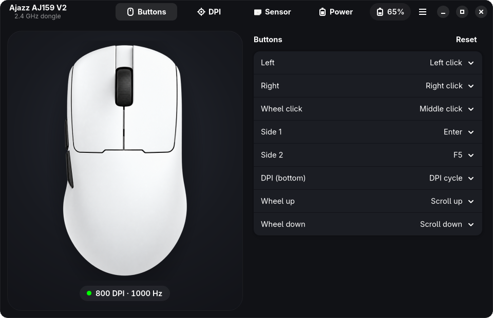

# Ajazz Mouse

A native Linux app for configuring the **Ajazz AJ159 V2** wireless mouse. It talks to the mouse
directly through the 2.4 GHz receiver, so you don't need a browser, Windows or the official web
driver. Built with GTK4 and libadwaita, dark theme.



[Русская версия](README.ru.md)

## What it can do

Everything the official driver page can do for this mouse:

- **Buttons**: left, right, wheel click, wheel up/down, both side buttons and the DPI button on the
  bottom. Assign mouse functions, DPI switching, media keys, copy/paste, browser keys, any key or
  shortcut, or a macro of up to 50 key events. **Reset** brings back the factory layout.
- **DPI**: six levels from 50 to 32000 in steps of 50, the active level and each level's indicator color.
- **Sensor**: polling rate 125/250/500/1000 Hz, lift-off distance 0.7/1/2 mm, Motion Sync,
  ripple control and angle snapping.
- **Power**: button debounce 4–50 ms, light sleep 10–600 s, deep sleep 1–60 min, DPI indicator mode.

The app also does a few things the official page doesn't:

- It **reads the current settings from the mouse** when it opens. The official page only shows
  what it saved itself.
- Every change is written right away and checked by reading it back.
- If the mouse is asleep, the app waits for you to move it and then retries.

The interface is in English, or in Russian when your system language is Russian.

## Install

Download a package from the [latest release](https://github.com/f0rd2017/ajazz-mouse/releases/latest).

**Debian 13+, Ubuntu 25.10+ and distros based on them:**

```bash
sudo apt install ./ajazz-mouse_*_amd64.deb
```

**Fedora 42+:**

```bash
sudo dnf install ./ajazz-mouse-*.x86_64.rpm
```

**Arch Linux and Arch-based distros** (Manjaro, EndeavourOS, CachyOS, Omarchy…):

```bash
git clone https://github.com/f0rd2017/ajazz-mouse
cd ajazz-mouse/packaging/aur
makepkg -si
```

Then open **Ajazz Mouse** from your app menu and plug in the receiver. If the app was already open
while the package was installing and still can't find the receiver, unplug it and plug it back in.

### Build from source (any distro)

You need Rust 1.92 or newer ([rustup.rs](https://rustup.rs)) and the development packages for
GTK 4.14+ and libadwaita 1.7+:

| Distro | Packages |
|---|---|
| Debian, Ubuntu | `build-essential pkg-config libgtk-4-dev libadwaita-1-dev` |
| Fedora | `gcc pkgconf-pkg-config gtk4-devel libadwaita-devel` |
| Arch | `base-devel gtk4 libadwaita` |
| openSUSE | `gcc pkgconf gtk4-devel libadwaita-devel` |

```bash
git clone https://github.com/f0rd2017/ajazz-mouse
cd ajazz-mouse
./install.sh
```

The script installs the app for your user (`~/.local/bin`, `~/.local/share`) and asks for your
password once to add the udev rule. To remove everything, run `./install.sh --uninstall`.

## Supported devices

| Device | Status |
|---|---|
| Ajazz AJ159 V2 over the 2.4 GHz receiver `1d57:fa60` (the mouse reports itself as V2MAX) | tested |
| AJ159 V2 over the USB cable | should work (same protocol), not tested |
| 8K receiver `1d57:fa65` | not supported: it uses a different protocol |

Other Ajazz mice that use the same receiver probably speak the same protocol, but their buttons
may be laid out differently. If you have one, please open an issue and include the output of
`grep -H . /sys/class/hidraw/*/device/uevent`.

## Troubleshooting

- **“Looking for the Ajazz dongle” never goes away.** Check that the receiver is listed by
  `lsusb | grep 1d57` and that the rule exists: either `/usr/lib/udev/rules.d/70-ajazz-mouse.rules`
  (packages) or `/etc/udev/rules.d/70-ajazz-mouse.rules` (`install.sh`). Then replug the receiver.
- **“The mouse is asleep”.** The mouse goes to sleep after 10 seconds of idle time by default. While
  it sleeps it ignores the receiver, so move the mouse and the app will continue.
- **A setting didn't stick.** Same reason: the mouse fell asleep while the app was writing. The app
  retries after the next movement and shows “Saved to the mouse” once the write is confirmed.

## How it works

The protocol was reverse-engineered from the official web driver (`ajazz.szslxd-tech.com`) and its
Windows and macOS helpers, then checked on the mouse. Settings live in HID feature reports on one of
the receiver's interfaces; reading needs a request report and a pause first. The format of every
report is described in [docs/PROTOCOL.md](docs/PROTOCOL.md). If you want to support this mouse in
another tool, that file is the place to start.

To run the tests: `cargo test` encodes and decodes settings and macros using bytes captured from a real mouse.

## Disclaimer

This is an unofficial project, not affiliated with or endorsed by Ajazz. The mouse picture in
`assets/mouse_top.png` is a generated illustration based on Ajazz's product photo.

## License

[MIT](LICENSE)
