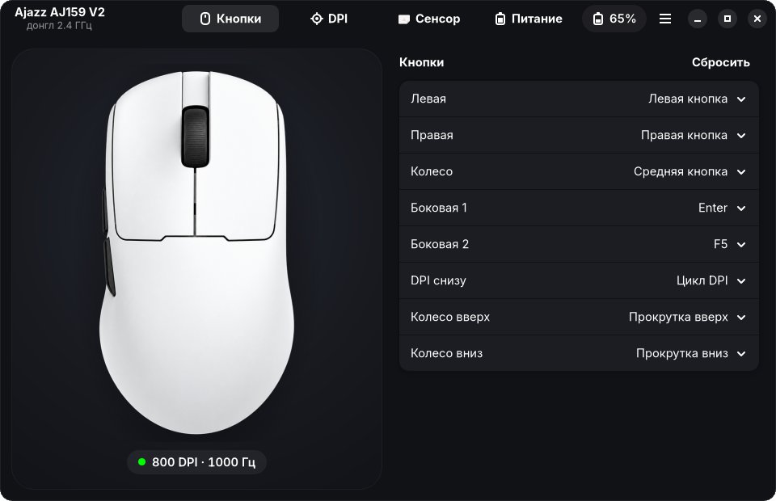

# Ajazz Mouse

Нативное приложение для настройки беспроводной мыши **Ajazz AJ159 V2** под Linux. Работает с мышью
напрямую через донгл 2.4 ГГц: не нужны ни браузер, ни Windows, ни официальный веб-драйвер.
GTK4 + libadwaita, тёмная тема.



[English version](README.md)

## Что умеет

Всё, что официальная страница драйвера умеет для этой мыши:

- **Кнопки** — левая, правая, нажатие колеса, прокрутка вверх и вниз, обе боковые и кнопка DPI
  на дне. Можно назначить функции мыши, переключение DPI, медиа, копирование и вставку, кнопки
  браузера, любую клавишу или сочетание, макрос до 50 событий. «Сбросить» возвращает заводские
  функции.
- **DPI** — 6 уровней от 50 до 32000 с шагом 50, активный уровень и цвет индикатора каждого уровня.
- **Сенсор** — частота опроса 125/250/500/1000 Гц, высота отрыва 0,7/1/2 мм, Motion Sync,
  подавление дрожания и выпрямление линий.
- **Питание** — отклик кнопок 4–50 мс, лёгкий сон 10–600 с, глубокий сон 1–60 мин, режим индикатора DPI.

Чего нет у официальной страницы:

- приложение при открытии **читает настройки из мыши**, а страница показывает только то, что
  сохранила у себя;
- любая правка сразу записывается в мышь и сверяется чтением;
- если мышь спит, приложение ждёт, пока её пошевелят, и повторяет запись.

Язык интерфейса — русский при русской локали системы, иначе английский.

## Установка

Пакеты лежат в [последнем релизе](https://github.com/f0rd2017/ajazz-mouse/releases/latest).

**Debian 13+, Ubuntu 25.10+ и системы на их основе:**

```bash
sudo apt install ./ajazz-mouse_*_amd64.deb
```

**Fedora 42+:**

```bash
sudo dnf install ./ajazz-mouse-*.x86_64.rpm
```

**Arch Linux и системы на его основе** (Manjaro, EndeavourOS, CachyOS, Omarchy…):

```bash
git clone https://github.com/f0rd2017/ajazz-mouse
cd ajazz-mouse/packaging/aur
makepkg -si
```

После установки открой **Ajazz Mouse** в меню и вставь донгл. Если приложение было открыто ещё до
установки пакета и не видит донгл, вынь его и вставь заново.

### Сборка из исходников (любой дистрибутив)

Нужны Rust 1.92 или новее ([rustup.rs](https://rustup.rs)) и пакеты для разработки с GTK 4.14+
и libadwaita 1.7+ (их список по дистрибутивам — в [английском README](README.md#build-from-source-any-distro)).

```bash
git clone https://github.com/f0rd2017/ajazz-mouse
cd ajazz-mouse
./install.sh
```

Скрипт ставит приложение для текущего пользователя (`~/.local/bin`, `~/.local/share`) и один раз
спрашивает пароль, чтобы добавить udev-правило. Удалить всё обратно — `./install.sh --uninstall`.

## Какие мыши поддерживаются

- **Ajazz AJ159 V2 через донгл 2.4 ГГц `1d57:fa60`** (мышь называет себя V2MAX) — проверено.
- AJ159 V2 по проводу — протокол тот же, должно работать, но не проверялось.
- 8K-донгл `1d57:fa65` — не поддерживается, у него другой протокол.

Другие мыши Ajazz на том же донгле, скорее всего, говорят на том же протоколе, но кнопки у них
могут быть расположены иначе. Если у тебя такая мышь, открой issue и приложи вывод
`grep -H . /sys/class/hidraw/*/device/uevent`.

## Если что-то не так

- **«Ищу донгл Ajazz» не пропадает.** Проверь, что донгл виден в `lsusb | grep 1d57` и что правило
  на месте: `/usr/lib/udev/rules.d/70-ajazz-mouse.rules` (из пакета) или
  `/etc/udev/rules.d/70-ajazz-mouse.rules` (из `install.sh`). Потом переподключи донгл.
- **«Мышь спит».** По умолчанию мышь засыпает через 10 секунд простоя и тогда не отвечает донглу.
  Пошевели её, и приложение продолжит.
- **Настройка не применилась.** Причина та же: мышь уснула во время записи. Приложение повторит
  запись после движения мыши и покажет «Сохранено в мышь», когда мышь подтвердит запись.

## Как это устроено

Протокол восстановлен по официальному веб-драйверу (`ajazz.szslxd-tech.com`) и его помощникам для
Windows и macOS, затем проверен на мыши. Настройки лежат в feature-отчётах HID на одном из
интерфейсов донгла. Перед чтением донглу отправляется запрос и выдерживается пауза. Формат всех отчётов —
в [docs/PROTOCOL.md](docs/PROTOCOL.md) (на английском). Если хочешь добавить эту мышь в другую
программу, начни с этого файла.

`cargo test` проверяет кодирование настроек и макросов на байтах, снятых с настоящей мыши.

## Оговорка

Проект неофициальный и не связан с Ajazz. Картинка мыши в `assets/mouse_top.png` сгенерирована
по фотографии с сайта Ajazz.

## Лицензия

[MIT](LICENSE)
